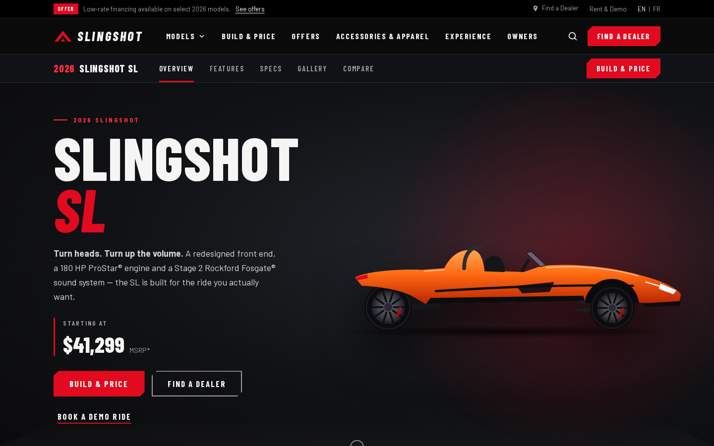
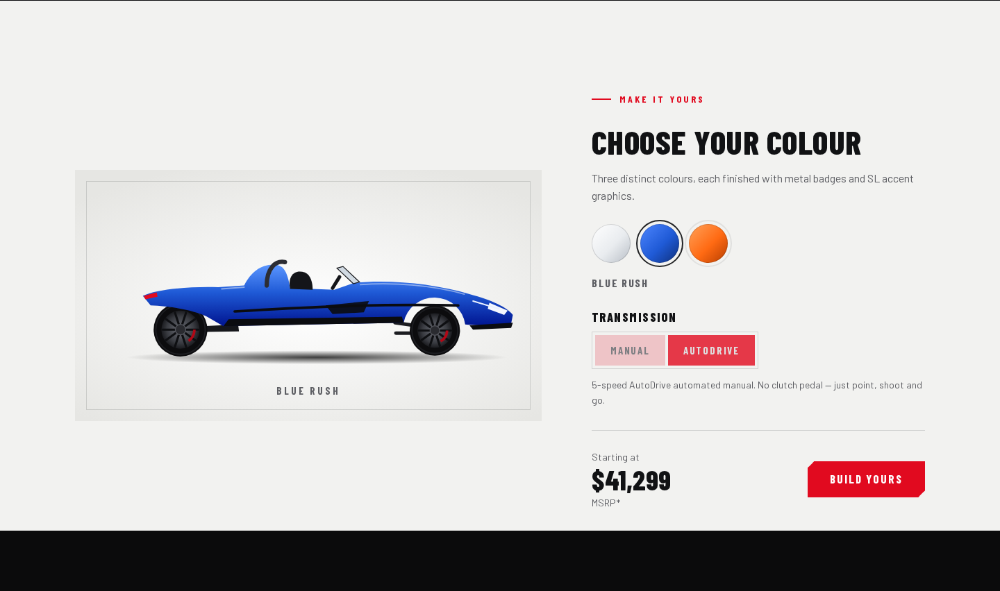
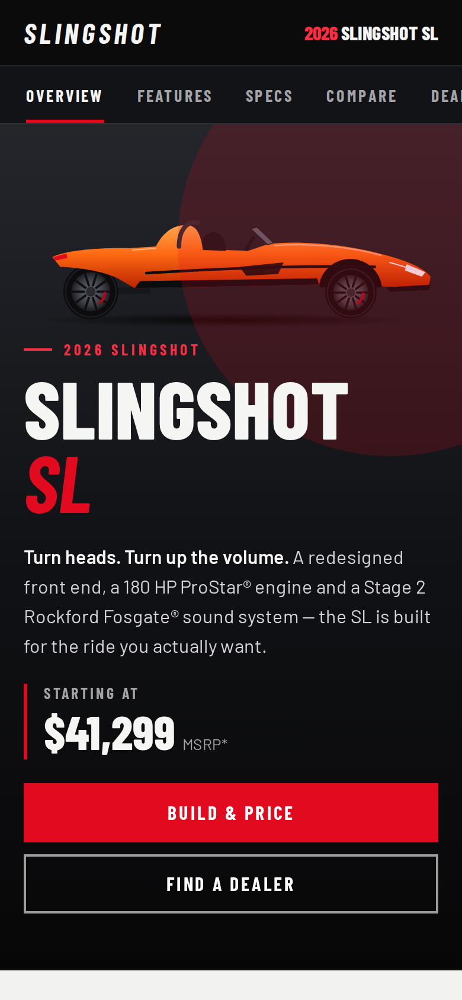
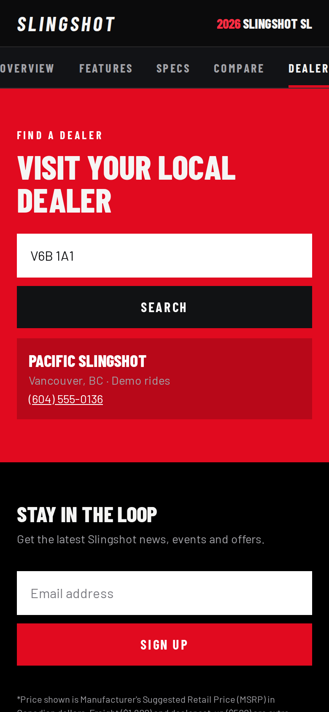

# Polarisslingshot

A full-stack recreation of the **2026 Slingshot SL** model page (en-CA), built as a TypeScript monorepo:

| App | Stack | Path |
| --- | --- | --- |
| Web | **Next.js 15.5** (App Router, React 19, `next/font`) | `apps/web` |
| API | **Express 5** + Zod, bundled with tsup | `apps/api` |
| Mobile | **React Native 0.86 / Expo SDK 57** + react-native-svg | `apps/mobile` |
| Shared | Content, specs, vehicle SVG geometry, validators | `packages/shared` |

All three apps read from `@slingshot/shared`, so copy, prices, specs and the vehicle
illustration only ever change in one place.



<p>
  
  
  
</p>

## Page sections

Utility bar (offer, dealer, EN/FR) · sticky header with **Models mega-menu**, search overlay and
mobile drawer · sticky **model sub-nav** with scroll-spy · **hero** with starting MSRP and CTAs ·
**colour + transmission configurator** (White Lightning, Blue Rush, Sunburst Orange / Manual,
AutoDrive) that recolours the vehicle live · animated **key stats** · four **feature** blocks
(front end, 7″ RIDE COMMAND®, Stage 2 Rockford Fosgate® 200 W, 180 HP ProStar® 2.0L) ·
**spec sheet** accordion per transmission with print styles · **gallery** with keyboard lightbox ·
**lineup compare** carousel · Build & Price CTA · offers · accessories · **dealer locator**
(postal-code search against the API) · newsletter · footer · legal disclaimers.

## Getting started

Requires Node 20.9+ (22 recommended).

```bash
npm install

npm run dev:api      # Express on http://localhost:4000
npm run dev:web      # Next.js on http://localhost:3000  (/ → /en-ca/slingshot-sl)
npm run dev:mobile   # Expo dev server (press i / a / w)
```

Environment variables (see each app's `.env.example`):

| Variable | App | Default |
| --- | --- | --- |
| `API_URL` | web | `http://localhost:4000` (server fetches + `/api/*` rewrite) |
| `SITE_URL` | web | `http://localhost:3000` (metadata base URL) |
| `PORT`, `CORS_ORIGINS` | api | `4000`, allow all |
| `EXPO_PUBLIC_API_URL` | mobile | `http://localhost:4000`; use your LAN IP on a device |

The web and mobile apps fall back to the bundled shared data if the API is unreachable,
so the site still builds and renders on its own.

## Scripts

```bash
npm run typecheck   # all workspaces
npm run lint        # web (ESLint 9 flat config)
npm test            # API tests (Vitest + Supertest)
npm run build       # API bundle + Next.js production build
npm start           # run the built API and web app
```

## API

| Method | Route | Description |
| --- | --- | --- |
| GET | `/api/health` | Health check |
| GET | `/api/models` | 2026 lineup |
| GET | `/api/models/:id` | Full model page (`sl`) with offers, accessories and disclaimers |
| GET | `/api/models/:id/specs?transmission=manual\|auto` | Spec sheet |
| GET | `/api/dealers?postal=M5V2T6[&demo=true]` | Dealers by Canadian postal code |
| POST | `/api/newsletter` | `{ email }` |
| POST | `/api/quotes` | `{ modelId, colorId, transmission, email, postal }` |

Newsletter sign-ups and quotes are kept in memory, and the dealer list is demo data.
Connect these to your CRM or database before going live.

## Before publishing

- **Verify all figures.** Prices and specs come from public sources and are marked in
  `packages/shared/src/data.ts`. Check them against the official spec sheet, especially the
  AutoDrive curb weight and the R / Signature Edition prices, which are shown as "see dealer".
- **Imagery.** The vehicle is a vector illustration so it can be recoloured live. To use real
  photography, drop licensed images into `apps/web/public` and swap them in for `<Vehicle />`
  in the relevant sections.
- **Trademarks.** Slingshot, Polaris, RIDE COMMAND, ProStar and AutoDrive are trademarks of
  Polaris Inc. Rockford Fosgate, Apple CarPlay and Bluetooth belong to their owners. Only
  deploy this publicly if you're authorised to use these marks (for example as a dealer).
