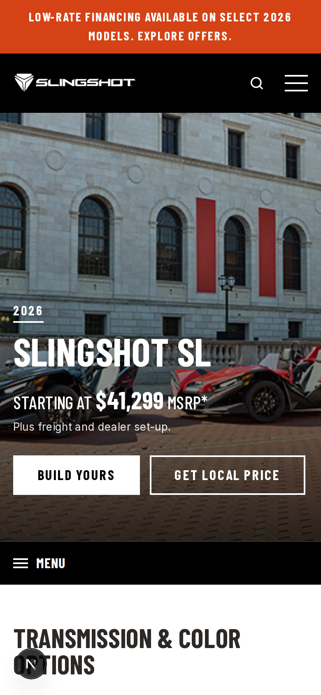

# Polarisslingshot

A full-stack recreation of the **2026 Slingshot SL** model page (en-CA), built as a TypeScript monorepo:

| App | Stack | Path |
| --- | --- | --- |
| Web | **Next.js 15.5** (App Router, React 19, `next/font`) | `apps/web` |
| API | **Express 5** + Zod, bundled with tsup | `apps/api` |
| Mobile | **React Native 0.86 / Expo SDK 57** | `apps/mobile` |
| Shared | Content, specs, image paths, validators | `packages/shared` |

All three apps read from `@slingshot/shared`, so copy, prices, specs and image paths only
ever change in one place. The layout follows the slingshot.polaris.com model pages, and all
photography lives in `apps/web/public/images` (the mobile app bundles the same files).


<p>
  
  
</p>

## Page sections

Promo bar · black header with **Vehicles mega-menu** (real lineup photos), search overlay and
mobile drawer · full-bleed photo **hero** with starting MSRP, Build Yours and Get Local Price ·
sticky **sub-nav** (Overview, Features, Specs, Compare) with scroll-spy · **Transmission & Color
Options** (White Lightning, Earth Blue, Spectra Orange / Manual, AutoDrive) with studio photos ·
offer banner · 7-slide **features carousel** · **key specifications** · **Take it for a spin**
colour viewer with standard equipment and the full **spec sheet** accordion (print styles) ·
**The Drive Starts Here** photo gallery with keyboard lightbox · **You may also like** lineup
carousel · **Arrive in your style** accessory-series tabs · apparel banner · shopping tools ·
**dealer locator** (postal-code search against the API) · legal disclaimers · newsletter · footer.

## Getting started

Requires Node 20.9+ (22 recommended).

```bash
npm install

npm run dev:api      # Express on http://localhost:4000
npm run dev:web      # Next.js on http://localhost:3000  (/ → /en-ca/slingshot-sl)
npm run dev:mobile   # Expo dev server (press i / a / w)
```

Environment variables (see each app's `.env.example`):

| Variable | App | Default |
| --- | --- | --- |
| `API_URL` | web | `http://localhost:4000` (server fetches + `/api/*` rewrite) |
| `SITE_URL` | web | `http://localhost:3000` (metadata base URL) |
| `PORT`, `CORS_ORIGINS` | api | `4000`, allow all |
| `EXPO_PUBLIC_API_URL` | mobile | `http://localhost:4000`; use your LAN IP on a device |

The web and mobile apps fall back to the bundled shared data if the API is unreachable,
so the site still builds and renders on its own.

## Scripts

```bash
npm run typecheck   # all workspaces
npm run lint        # web (ESLint 9 flat config)
npm test            # API tests (Vitest + Supertest)
npm run build       # API bundle + Next.js production build
npm start           # run the built API and web app
```

## API

| Method | Route | Description |
| --- | --- | --- |
| GET | `/api/health` | Health check |
| GET | `/api/models` | 2026 lineup |
| GET | `/api/models/:id` | Full model page (`sl`) with offers, accessories and disclaimers |
| GET | `/api/models/:id/specs?transmission=manual\|auto` | Spec sheet |
| GET | `/api/dealers?postal=M5V2T6[&demo=true]` | Dealers by Canadian postal code |
| POST | `/api/newsletter` | `{ email }` |
| POST | `/api/quotes` | `{ modelId, colorId, transmission, email, postal }` |

Newsletter sign-ups and quotes are kept in memory, and the dealer list is demo data.
Connect these to your CRM or database before going live.

## Before publishing

- **Verify all figures.** Prices and specs come from public sources and are marked in
  `packages/shared/src/data.ts`. Check them against the official spec sheet, especially the
  AutoDrive curb weight and the R / Signature Edition prices, which are shown as "see dealer".
- **Imagery.** Photos in `apps/web/public/images` were downloaded from Polaris's CDN
  (cdn1.polaris.com) and are Polaris's copyrighted material. The vehicle and colour shots are
  the 2026 Slingshot SL; the lifestyle scenes (hero, features, gallery, accessories) are
  Slingshot S photos, because no SL-specific scenes were available. Replace them with licensed
  SL photography where it matters, and confirm you have the rights before deploying.
- **Trademarks.** Slingshot, Polaris, RIDE COMMAND, ProStar and AutoDrive are trademarks of
  Polaris Inc. Rockford Fosgate, Apple CarPlay and Bluetooth belong to their owners. Only
  deploy this publicly if you're authorised to use these marks (for example as a dealer).
